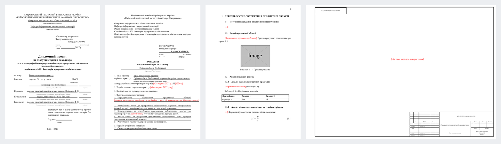

# kpi-thesis

LaTeX-клас і шаблони для дипломного проєкту бакалавра й курсових робіт КПІ ім. Ігоря
Сікорського, ФІОТ, кафедра інформатики та програмної інженерії (ОП «Інженерія програмного
забезпечення інформаційних систем»). Плюс лінтер нормоконтролю і плагін для Claude Code.

*LaTeX class and templates for a KPI FICE bachelor diploma and courseworks (ДСТУ 3008:2015),
with a normcontrol linter and a Claude Code plugin. Docs are in Ukrainian.*



## Що всередині

- **Увесь пакет диплома** з одного `meta.tex`: титульний лист, завдання з календарним планом,
  анотації українською й англійською, відомість проєкту зі штампом ЄСКД, ТЗ, пояснювальна
  записка, текст програми, програма та методика тестування, керівництво користувача, аркуші
  графічного матеріалу А3. Шифри, ПІБ і дати наказу пишуться один раз.
- **Оформлення за ДСТУ 3008:2015 і методичкою кафедри**: поля, шрифти, заголовки, підписи
  рисунків і таблиць, «Продовження таблиці N», формули з «де», переліки, додатки.
- **Числа для анотації й відомості рахуються самі**: сторінки, рисунки, таблиці, джерела, додатки.
- **`just check`** знаходить те, що чіпляє нормоконтроль: порядок джерел, рисунки й таблиці без
  посилань, «де:» з двокрапкою, десяткові крапки, довге тире, заглушки, довгу анотацію, «??».
- **Шаблон курсової** — той самий клас, один документ.
- **Плагін для Claude Code** — скіл, що знає структуру диплома, правила й граблі класу.

Сам клас працює і без Claude.

## Встановлення

Потрібні:

- **TeX Live** (XeLaTeX, latexmk): на macOS — MacTeX;
- **шрифти Times New Roman і Courier New**;
- [**just**](https://github.com/casey/just) — запуск команд;
- **Python 3** — для `just check`;
- **poppler** (`pdfunite`, `pdftotext`) — зведений PDF диплома й перевірка анотації.

<details open>
<summary><b>macOS</b></summary>

```sh
brew install --cask mactex-no-gui
brew install just poppler
```

Times New Roman і Courier New у macOS уже є.
</details>

<details>
<summary><b>Linux (Debian / Ubuntu)</b></summary>

```sh
sudo apt install texlive-xetex texlive-latex-extra texlive-fonts-recommended \
  texlive-plain-generic texlive-lang-cyrillic latexmk poppler-utils python3 ttf-mscorefonts-installer
```

Шрифти Microsoft ставить `ttf-mscorefonts-installer` (погодитися з ліцензією).
`just` у репозиторіях дистрибутивів часто застарий або його немає — поставте бінарник із
[релізів](https://github.com/casey/just/releases) (потрібна версія 1.21 або новіша).
</details>

<details>
<summary><b>Windows</b></summary>

1. [TeX Live](https://tug.org/texlive/windows.html) (MiKTeX теж збере, але `just install`
   розрахований на TeX Live).
2. [Git for Windows](https://git-scm.com/download/win) — рецепти `just` виконуються в Git Bash.
3. `winget install Casey.Just Python.Python.3.12` і poppler (`scoop install poppler`).

Times New Roman і Courier New у Windows уже є. Команди нижче — у Git Bash. Без симлінків
`just install` копіює клас, тож після `git pull` його треба запустити ще раз.
Альтернатива — WSL з інструкцією для Linux.
</details>

Далі на будь-якій ОС:

```sh
git clone https://github.com/sokolovgit/kpi-thesis ~/kpi-thesis
cd ~/kpi-thesis
just install        # клас стає видимим для TeX (TEXMFHOME)
just test           # необов'язково: збирає обидва шаблони
```

### Плагін для Claude Code

```
/plugin install kpi-thesis --marketplace sokolovgit/kpi-thesis
```

Або з терміналу: `claude plugin install kpi-thesis --marketplace sokolovgit/kpi-thesis`.
У старіших версіях Claude Code — двома командами:

```
/plugin marketplace add sokolovgit/kpi-thesis
/plugin install kpi-thesis@kpi-thesis
```

Скіл вмикається сам, коли йдеться про диплом, курсову чи нормоконтроль, або командою
`/kpi-thesis:kpi-thesis`. Клас плагін не ставить — потрібні кроки вище; якщо їх не зроблено,
Claude запропонує клонувати репозиторій. Оновлення: `/plugin marketplace update kpi-thesis`.

Без плагіна: `just install-skill` робить симлінк скіла в `~/.claude/skills` з клону, тоді
скіл оновлюється разом із `git pull`. Обидва способи разом не вмикайте.

## Використання

```sh
cd ~/kpi-thesis
just new diploma ~/kpi/diploma      # або: just new coursework ~/kpi/coursework
cd ~/kpi/diploma
$EDITOR meta.tex                    # тема, ПІБ, група, наказ, дати
just all                            # усі документи → build/<OUT>.pdf
just check                          # перевірки нормоконтролю
```

Усередині роботи: `just build explanatory-note` — один документ, `just watch explanatory-note` — перезбирання при
збереженні, `just stats` — числа для анотації, `just clean` — прибрати проміжні файли.

Свій текст пишіть у `explanatory-note/chapters/*.tex`, картинки кладіть у `media/`. Основні команди класу:

| Що | Як |
|---|---|
| Структурний елемент без номера | `\structural{ВСТУП}` |
| Таблиця з «Продовження таблиці N» | `\begin{kpitable}{|p{4cm}|p{10cm}|}{Назва\label{tab:key}}{\textbf{А} & \textbf{Б}} … \end{kpitable}` |
| Пояснення до формули | `\begin{where} M & маса, кг; \\ F & сила, Н. \end{where}` |
| Додатки | `\appendices`, далі `\appendix{Назва}` або `\appendixpdf{Звіт подібності}{../media/report.pdf}` (шлях від файлу документа) |
| Лістинг у тексті програми | `\codefile{path}{задача}` + `\lstinputlisting{../../repo/file}` |
| Аркуш А3 | `\diagramPage{ССВ}{Назва схеми}{file.png}` |
| Заглушка | `\todo{...}` — червона в PDF, `just check` її рахує |

Повніший довідник — [`skills/kpi-thesis/SKILL.md`](skills/kpi-thesis/SKILL.md), граблі —
[`gotchas.md`](skills/kpi-thesis/references/gotchas.md).

## Джерела вимог

Шаблони зроблено за такими документами (детально, з номерами пунктів і тим, де вони
розходяться, — [`requirements.md`](skills/kpi-thesis/references/requirements.md)):

1. Методичка кафедри: [«Дипломний проєкт: організація виконання та захисту, вимоги до
   структури, змісту та оформлення»](https://ela.kpi.ua/items/12c93c43-d06a-401c-8ff4-a38354c1c0b5),
   навч. посіб., 2-ге вид., КПІ ім. Ігоря Сікорського, 2024 (Стеценко І. В., Ліхоузова Т. А.,
   Ліщук К. І., Марченко О. І., Головченко М. М.).
2. ДСТУ 3008:2015 «Звіти у сфері науки і техніки. Структура та правила оформлювання».
3. ДСТУ 8302:2015 «Бібліографічне посилання. Загальні положення та правила складання».
4. ЄСПД: ГОСТ 19.201-78 (ТЗ), 19.301-79 (ПМТ), 19.505-79 (керівництво користувача),
   19.504-79 і 19.503-79 (керівництва програміста й системного програміста).
5. ДСТУ ГОСТ 2.104:2006 — основні написи (штампи відомості й графічного матеріалу).
6. Чекліст нормоконтролю й шаблони Word кафедри 2026 року; дипломи кафедри 2025–2026, що
   пройшли нормоконтроль.

Методичку й вимоги кафедри час від часу оновлюють — звіряйтеся з актуальною редакцією і з
керівником. Шаблон курсової бере оформлення диплома; склад розділів звіряйте з методичкою своєї
дисципліни.

## Обмеження

- **Лише XeLaTeX** (`fontspec`); pdfLaTeX не підтримується.
- **Overleaf** не має Times New Roman і Courier New. Можна завантажити `.ttf` у проєкт і
  вказати їх у `\setmainfont`, або замінити на TeX Gyre Termes / Cursor, але це вже не точно
  те, що вимагає методичка. Основний сценарій — локальна збірка.
- Рецепти `just` — для bash; на Windows потрібен Git Bash або WSL.

## Структура репозиторію

| Шлях | Що |
|---|---|
| `tex/kpi-thesis.cls` | сторінка, шрифти, заголовки, підписи, `kpitable`, `where`, переліки, додатки, лістинги, підрахунок чисел |
| `tex/kpi-titles.sty` | `\kpiset{...}`, титул, завдання, анотації, відомість, титули документів |
| `tex/kpi-graphics.sty` | аркуші А3 зі штампом ЄСКД |
| `templates/diploma/` | `meta.tex` + документи диплома: `title` (титул, завдання, анотації, відомість), `specification` (ТЗ), `explanatory-note` (ПЗ), `source-code` (текст програми), `test-plan` (ПМТ), `user-manual` (КК), `graphics` (графічний матеріал) |
| `templates/coursework/` | курсова, один документ |
| `scripts/check.py` | лінтер нормоконтролю |
| `skills/kpi-thesis/` | скіл Claude Code: процес, правила, вимоги з номерами пунктів, граблі |
| `.claude-plugin/` | маніфест плагіна й маркетплейсу |

## Участь

Знайшли розбіжність з методичкою чи зауваження нормоконтролю, якого клас не враховує, —
відкрийте issue або PR. Перед PR запустіть `just test`.

## Автори

- Олександр Соколов ([@sokolovgit](https://github.com/sokolovgit))
- Михайло Разбейко ([@MykhailoRp](https://github.com/MykhailoRp))

## Ліцензія

[MIT](LICENSE). Роботи, написані за шаблонами, — ваші: зберігати в них ліцензійне повідомлення
не потрібно.
