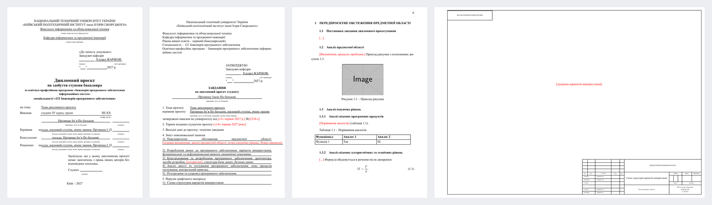

# kpi-thesis

[](https://ctan.org/pkg/kpi-thesis)

LaTeX-клас і шаблони для дипломного проєкту бакалавра й курсових робіт КПІ ім. Ігоря
Сікорського, ФІОТ, кафедра інформатики та програмної інженерії (ОП «Інженерія програмного
забезпечення інформаційних систем»). Плюс лінтер нормоконтролю і плагін для Claude Code.

*LaTeX class and templates for a KPI FICE bachelor diploma and courseworks (ДСТУ 3008:2015),
with a normcontrol linter and a Claude Code plugin. Docs are in Ukrainian.*



## Що всередині

- **Увесь пакет диплома** з одного `meta.tex`: титульний лист, завдання з календарним планом,
  анотації українською й англійською, відомість проєкту зі штампом ЄСКД, ТЗ, пояснювальна
  записка, текст програми, програма та методика тестування, керівництво користувача, аркуші
  графічного матеріалу А3. Шифри, ПІБ і дати наказу пишуться один раз.
- **Оформлення за ДСТУ 3008:2015 і методичкою кафедри**: поля, шрифти, заголовки, підписи
  рисунків і таблиць, «Продовження таблиці N», формули з «де», переліки, додатки.
- **Числа для анотації й відомості рахуються самі**: сторінки, рисунки, таблиці, джерела, додатки.
- **`just check`** знаходить те, що чіпляє нормоконтроль: порядок джерел, рисунки й таблиці без
  посилань, рисунки далі ніж на наступній сторінці після згадки, «де:» з двокрапкою, десяткові
  крапки, запис чисел, довге тире, `\ldots` замість `\cdots`, заглушки, довгу анотацію, «??»,
  заголовки з крапкою, URL без дати звернення, неповний склад диплома й незаповнені штампи.
- **Шаблон курсової** — той самий клас, один документ.
- **Плагін для Claude Code** — скіл, що знає структуру диплома, правила й граблі класу.

Сам клас працює і без Claude.

## Встановлення

Потрібні:

- **TeX Live** (LuaLaTeX, latexmk): на macOS — MacTeX;
- **шрифти Times New Roman і Courier New** — без них клас підставить TeX Gyre Termes / Cursor
  і попередить, але методичка вимагає саме Times New Roman;
- [**just**](https://github.com/casey/just) — запуск команд;
- **Python 3** — для `just check`;
- **poppler** (`pdfunite`, `pdftotext`) — необов'язково: швидше зведення PDF диплома і
  перевірки анотації та обсягу за готовим PDF.

<details open>
<summary><b>macOS</b></summary>

```sh
brew install --cask mactex-no-gui
brew install just poppler
```

MacTeX — це `.pkg`: інсталятор попросить пароль і займе кілька ГБ (10–20 хв).
Times New Roman і Courier New у macOS уже є.
</details>

<details>
<summary><b>Linux (Debian / Ubuntu)</b></summary>

```sh
sudo apt install texlive-luatex texlive-latex-extra texlive-fonts-recommended \
  texlive-plain-generic texlive-lang-cyrillic latexmk fonts-texgyre poppler-utils python3 ttf-mscorefonts-installer
```

Шрифти Microsoft ставить `ttf-mscorefonts-installer` (погодитися з ліцензією).
`just` у репозиторіях дистрибутивів часто застарий або його немає — поставте бінарник із
[релізів](https://github.com/casey/just/releases) (потрібна версія 1.21 або новіша).
</details>

<details>
<summary><b>Windows</b></summary>

1. [TeX Live](https://tug.org/texlive/windows.html) (MiKTeX теж збере, але `just install`
   розрахований на TeX Live).
2. [Git for Windows](https://git-scm.com/download/win) — рецепти `just` виконуються в Git Bash.
3. `winget install Casey.Just`, потім `winget install Python.Python.3.12`.

Times New Roman і Courier New у Windows уже є. Команди нижче — у Git Bash. `just install`
робить junction (права адміністратора не потрібні), тож `git pull` одразу оновлює клас.
Альтернатива — WSL з інструкцією для Linux.
</details>

Далі на будь-якій ОС:

```sh
git clone https://github.com/sokolovgit/kpi-thesis ~/kpi-thesis
cd ~/kpi-thesis
just install        # клас стає видимим для TeX (TEXMFHOME)
just test           # необов'язково: збирає обидва шаблони, має закінчитися рядком OK
```

### Overleaf

[](https://www.overleaf.com/docs?snip_uri=https://github.com/sokolovgit/kpi-thesis/releases/latest/download/kpi-thesis-coursework-overleaf.zip&engine=lualatex)

Кнопка відкриває шаблон курсової з останнього релізу як новий проєкт Overleaf (потрібен вхід в
акаунт). Те саме вручну: `kpi-thesis-coursework-overleaf.zip` з
[релізів](https://github.com/sokolovgit/kpi-thesis/releases) → New Project → Upload Project.
Компілятор — LuaLaTeX (Menu → Compiler), шрифти Times New Roman і Courier New в Overleaf є.
`just check` і плагін в Overleaf не працюють: для них — локальна збірка.

### Лише клас: TeX Live, MiKTeX, CTAN

Клас є на [CTAN](https://ctan.org/pkg/kpi-thesis), у TeX Live і MiKTeX: `tlmgr install kpi-thesis`
(MiKTeX пропонує доставити його сам під час першої збірки). Цього досить, щоб писати
`\documentclass{kpi-thesis}` у своєму документі. Шаблони, `just check` і плагін — лише в
репозиторії, тож для повного сценарію клонуйте його, як вище. Клас із клону (`just install`)
має перевагу над версією з TeX Live.

### Плагін для Claude Code

```
/plugin install kpi-thesis --marketplace sokolovgit/kpi-thesis
```

Або з терміналу: `claude plugin install kpi-thesis --marketplace sokolovgit/kpi-thesis`.
У старіших версіях Claude Code — двома командами:

```
/plugin marketplace add sokolovgit/kpi-thesis
/plugin install kpi-thesis@kpi-thesis
```

Скіл вмикається сам, коли йдеться про диплом, курсову чи нормоконтроль, або командою
`/kpi-thesis:kpi-thesis`. Клас плагін не ставить — потрібні кроки вище; якщо їх не зроблено,
Claude проведе через встановлення.

Плагін і клас оновлюються окремо: скіл — `/plugin marketplace update kpi-thesis` (або
увімкніть auto-update у `/plugin` → Marketplaces), клас — `git pull` у клоні. Скіл сам
підкаже, якщо клон відстає. Що змінилося — у [CHANGELOG](CHANGELOG.md).

Без плагіна: `just install-skill` робить симлінк скіла в `~/.claude/skills` з клону, тоді
скіл оновлюється разом із `git pull`. Обидва способи разом не вмикайте.

### Плагін для OpenCode

Той самий скіл працює і в OpenCode: `just install-opencode-skill` робить симлінк у
`~/.config/opencode/skills/kpi-thesis` з клону, тоді скіл оновлюється разом із `git pull`.
Клас ця команда не ставить — потрібен `just install` вище.

В ізольованому середовищі (Docker чи sandbox), де `~/.config/opencode` недоступний, скопіюйте
теку `skills/kpi-thesis` в `.opencode/skills/kpi-thesis` усередині робочої директорії проєкту.

## Використання

```sh
cd ~/kpi-thesis
just new diploma ~/kpi/diploma      # або: just new coursework ~/kpi/coursework
cd ~/kpi/diploma
$EDITOR meta.tex                    # тема, ПІБ, група, наказ, дати
just all                            # усі документи → build/<Прізвище>_<група>.pdf
just check                          # перевірки нормоконтролю
```

Усередині роботи: `just build explanatory-note` — один документ, `just watch explanatory-note` — перезбирання при
збереженні, `just stats` — числа для анотації, `just clean` — прибрати `build/` разом із PDF,
`just clean-aux` — лише проміжні файли, `just freeze` — заморозити версію класу для роботи на здачі.

Ім'я зведеного PDF береться з `meta.tex` (прізвище зі `student-stamp` і `group`); у курсовій —
із шапки `main.tex`.

Свій текст пишіть у `explanatory-note/chapters/*.tex`, картинки кладіть у `media/`. Таблиці з
«Продовження таблиці N» — `kpitable`, пояснення до формул — `where`, заглушки — `\todo{...}`
(червоні в PDF, `just check` їх рахує). Усі команди класу — у
[`SKILL.md`](skills/kpi-thesis/SKILL.md#команди-класу), граблі — у
[`gotchas.md`](skills/kpi-thesis/references/gotchas.md).

Курсова: склад розділів беріть з методички своєї дисципліни. Де вона розходиться з
дипломною (поля 20 мм, без переносів, переліки «1)», підпис таблиці від краю, «Додаток А.
Назва» одним рядком, псевдокод), — `\kpisetup{...}` у `main.tex`, приклад там уже є.

Список джерел — у `sources.bib` поруч з документом: стиль `kpi-thesis-dstu` (biblatex + biber)
оформлює описи за ДСТУ 8302:2015 і ставить їх у порядку першої згадки
(`\kpisetup{sources=alphabetical}` або `chronological` — інший порядок). Робота з
`thebibliography` збирається як і раніше.

Шаблони мають налаштування для VS Code (LaTeX Workshop) і Zed: збірка з кнопки редактора
йде тим самим `latexmk`, що й `just`, а chktex не засипає хибними попередженнями
(`.chktexrc`).

## Джерела вимог

Шаблони зроблено за такими документами (детально, з номерами пунктів і тим, де вони
розходяться, — [`requirements.md`](skills/kpi-thesis/references/requirements.md)):

1. Методичка кафедри: [«Дипломний проєкт: організація виконання та захисту, вимоги до
   структури, змісту та оформлення»](https://ela.kpi.ua/items/12c93c43-d06a-401c-8ff4-a38354c1c0b5),
   навч. посіб., 2-ге вид., КПІ ім. Ігоря Сікорського, 2024 (Стеценко І. В., Ліхоузова Т. А.,
   Ліщук К. І., Марченко О. І., Головченко М. М.).
2. ДСТУ 3008:2015 «Звіти у сфері науки і техніки. Структура та правила оформлювання».
3. ДСТУ 8302:2015 «Бібліографічне посилання. Загальні положення та правила складання».
4. ЄСПД: ГОСТ 19.201-78 (ТЗ), 19.301-79 (ПМТ), 19.505-79 (керівництво користувача),
   19.504-79 і 19.503-79 (керівництва програміста й системного програміста).
5. ДСТУ ГОСТ 2.104:2006 — основні написи (штампи відомості й графічного матеріалу).
6. Чекліст нормоконтролю й шаблони Word кафедри 2026 року; дипломи кафедри 2025–2026, що
   пройшли нормоконтроль.

Методичку й вимоги кафедри час від часу оновлюють — звіряйтеся з актуальною редакцією і з
керівником. Шаблон курсової бере оформлення диплома; склад розділів звіряйте з методичкою своєї
дисципліни.

## Обмеження

- **LuaLaTeX** (`fontspec`). XeLaTeX ще збирає, з попередженням: команда LaTeX більше не
  розвиває XeTeX і радить LuaTeX. pdfLaTeX не підтримується.
- **Overleaf** — лише курсова (див. «Overleaf» вище). Диплом — кілька документів зі спільним
  `meta.tex` і зведенням в один PDF, тож його основний сценарій — локальна збірка.
- Рецепти `just` — для bash; на Windows потрібен Git Bash або WSL.

## Структура репозиторію

| Шлях | Що |
|---|---|
| `tex/kpi-thesis.cls` | сторінка, шрифти, заголовки, підписи, додатки, список джерел, лістинги |
| `tex/kpi-thesis-titles.sty` | `\kpiset{...}`, титул, завдання, анотації, відомість, титули документів |
| `tex/kpi-thesis-graphics.sty` | аркуші А3 зі штампом ЄСКД |
| `tex/kpi-thesis-dstu.{bbx,cbx}` | стиль biblatex за ДСТУ 8302:2015 |
| `tex/kpi-thesis-{tables,where,lists,stats}.sty` | `kpitable`, `where`, переліки «а)», підрахунок для анотації; клас підключає їх сам |
| `tex/kpi-titles.sty`, `tex/kpi-graphics.sty` | старі імена (до v2), лише підключають нові |
| `templates/diploma/` | `meta.tex` + документи диплома: `title` (титул, завдання, анотації, відомість), `specification` (ТЗ), `explanatory-note` (ПЗ), `source-code` (текст програми), `test-plan` (ПМТ), `user-manual` (КК), `graphics` (графічний матеріал) |
| `templates/coursework/` | курсова, один документ |
| `scripts/check.py` | лінтер нормоконтролю (`tests/` — його тести) |
| `docs/kpi-thesis-doc.tex`, `ctan/` | документація пакета й опис для CTAN (`just ctan`, `just ctan-validate <email>`) |
| `docs/RELEASING.md`, `scripts/release_check.py` | як випускати реліз і оновлювати CTAN (`just release-check`, `just ctan-submit <email>`) |
| `skills/kpi-thesis/` | скіл Claude Code: процес, правила, вимоги з номерами пунктів, граблі |
| `.claude-plugin/` | маніфест плагіна й маркетплейсу |

## Участь

Знайшли розбіжність з методичкою чи зауваження нормоконтролю, якого клас не враховує, —
відкрийте issue або PR. Перед PR запустіть `just test` і `python3 -m unittest discover -s tests`
(тести `check.py`, TeX не потрібен).

## Автори

- Олександр Соколов ([@sokolovgit](https://github.com/sokolovgit))
- Михайло Разбейко ([@MykhailoRp](https://github.com/MykhailoRp))

## Ліцензія

[MIT](LICENSE); `templates/` — додатково під MIT-0. Роботи, написані за шаблонами, — ваші:
зберігати в них ліцензійне повідомлення не потрібно.
